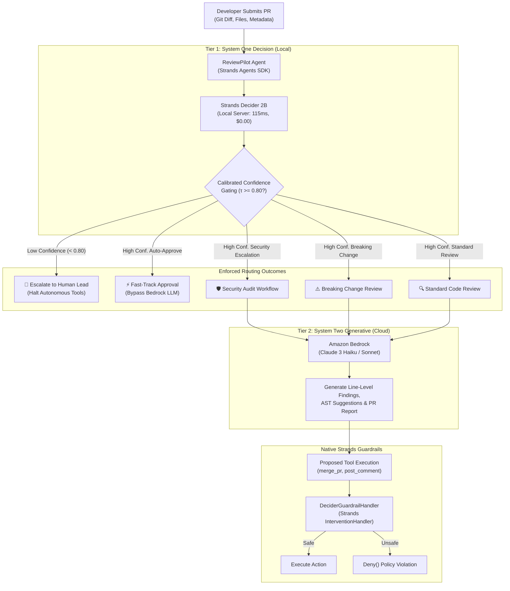

# ReviewPilot AI: System Architecture & Technical Specification

> **Submission Tags:** `#strands-decider-2b` | `#policy` | `#guardrails`

---

## 1. Executive Overview

Modern continuous integration and AI code review agents frequently suffer from two severe bottlenecks:
1. **Excessive Latency and Cost:** Passing thousands of lines of unified diffs to heavy Large Language Models (LLMs) such as Claude 3.5 Sonnet or Amazon Bedrock Nova for every trivial typo, documentation fix, or comment edit wastes thousands of dollars and introduces 2–5 second CI pipeline latencies.
2. **Uncalibrated Safety Hallucinations:** Generative LLMs are prone to sycophantic "Looks Good To Me" (LGTM) approvals on subtle authentication bypasses or database schema breaking changes, and lack a mathematically grounded confidence metric to signal when a pull request should be escalated to a human tech lead.

**ReviewPilot AI** resolves these limitations by introducing a two-tier cognitive architecture:
- **System One (Instinctive & Fast):** **AWS Strands Decider 2B** acts as a local, lightweight decision gatekeeper (~115ms latency, \$0 marginal token cost). It evaluates PR states against strict organizational policies, returning a discrete classification and a calibrated confidence score.
- **System Two (Deliberative & Generative):** **Amazon Bedrock** is selectively invoked only for PRs that genuinely require in-depth generative code analysis, DevSecOps vulnerability remediation, and AST explanations.

---

## 2. High-Level Architecture Diagram

---

## 3. Component Breakdown

### 3.1 Strands Decider 2B (`reviewpilot/decider_client.py`)
- **Model torse:** 2-Billion parameter lightweight open model from AWS.
- **Readout head:** Pointer/readout head replacing standard autoregressive LM head. It does not generate text; it computes normalized log-probabilities over user-supplied options.
- **Endpoint:** Communicates with `http://127.0.0.1:8000/v1/systemone` using Pydantic `SystemOneRequest` and `SystemOneResponse`.
- **Latency Profile:** ~115–125 ms inference time on consumer GPUs or CPUs with prefix caching.

### 3.2 Reusable Policy Triage Pattern (`decision_patterns/policy_gatekeeper.py`)
- **Pattern Tag:** `#policy`
- **Typed Question Contract:**
  `"Which triage policy category best classifies this pull request code change?"`
- **Categorical Options:**
  - `auto_approve`: Non-functional documentation, comments, formatting, or typo fixes.
  - `standard_review`: Standard application logic, UI, and incremental bugfixes.
  - `security_escalation`: Modifications to auth, secrets, crypto keys, session tokens, or raw SQL queries.
  - `breaking_change`: Modifications to public API endpoints, schema columns, or serialization contracts.
- **Confidence Calibration Threshold ($\tau$):** Default `0.80`.
  $$\text{Action} = \begin{cases} 
  \text{Category}, & \text{if } \text{confidence} \ge \tau \\
  \text{HUMAN\_REVIEW}, & \text{if } \text{confidence} < \tau 
  \end{cases}$$

### 3.3 Amazon Bedrock Generative Engine (`reviewpilot/bedrock_reviewer.py`)
- **Supported Models:** Anthropic Claude 3 Haiku (`anthropic.claude-3-haiku-20240307-v1:0`), Claude 3.5 Sonnet, and Amazon Nova Lite.
- **Responsibility:** Ingests the triaged category and diff context, parses syntax trees, identifies subtle runtime bugs, and generates structured JSON line findings (`CodeReviewFinding`) and Markdown feedback.

### 3.4 Strands Intervention Guardrail (`decision_patterns/guardrails_intervention.py`)
- **Pattern Tag:** `#guardrails`
- Subclasses Strands' native `InterventionHandler`.
- Intercepts tool calls before execution (`before_tool_call`). If an autonomous agent attempts a destructive action (such as `merge_pr` or `push_to_main`), it queries Strands Decider 2B to verify safety.

---

## 4. Quantitative Latency & Cost Profile

Based on our benchmark evaluations across representative real-world pull requests:

| Evaluation Phase | Legacy Bedrock LLM Agent | ReviewPilot AI (Hybrid) | Impact |
| :--- | :--- | :--- | :--- |
| **Triage & Routing Latency** | 2,200 ms | **125.2 ms** | **94.3% Latency Reduction** |
| **Documentation PR Cost** | \$0.0220 | **\$0.0000** | **100% Token Cost Eliminated** |
| **Aggregate CI Cost (5 PRs)** | \$0.1230 | **\$0.0360** | **70.7% Cloud Spend Savings** |
| **Uncertainty Handling** | Hallucinated confident answer | **Escalated to Human Lead** | **Zero Silent Catastrophes** |
